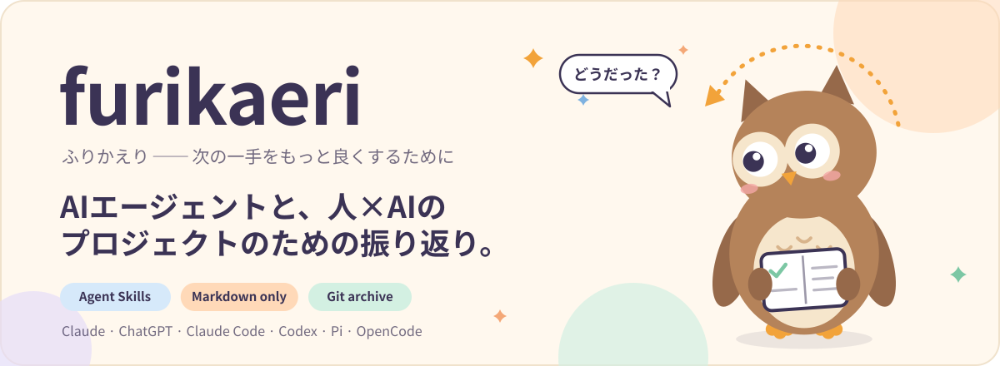
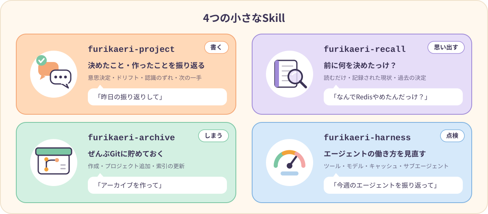
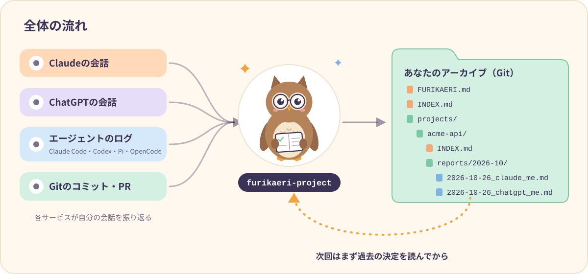
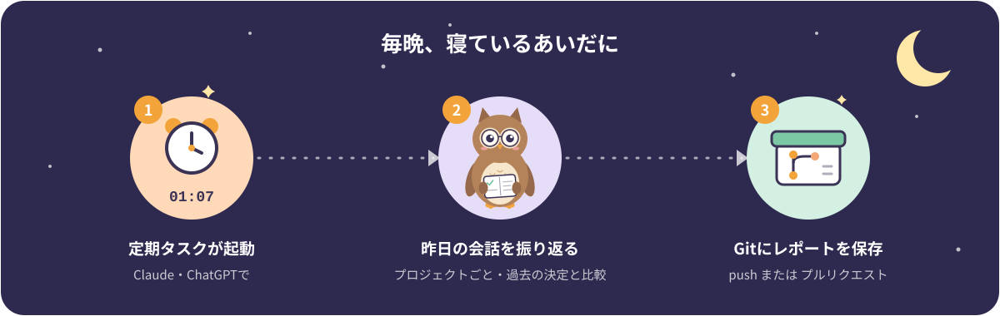

<p align="center">
  
</p>

<p align="center">
  <a href="README.md">English</a> · <b>日本語</b>
</p>

<p align="center">
  
  
  
  
</p>

**furikaeri（振り返り）** は、やったことを振り返って、次の一手をもっと良くするための [Agent Skills](https://agentskills.io) です。

3つの小さなSkillが、**エージェントがどう働いたか**と、**あなたとAIが何を決めて何を作ったか**を振り返ります。その結果は **Gitのアーカイブ**に貯まり、次に振り返るときはどのエージェントもまずそこを読みます。中身はただのMarkdownです。スクリプトもデータベースも不要で、作業中のプロジェクトには何もインストールしません。

<p align="center">
  
</p>

| Skill | 見るもの | 得られるもの |
|---|---|---|
| **`furikaeri-harness`** | セッションログ：ツール呼び出し、Skill、モデル、トークンとキャッシュヒット、コンパクション、サブエージェント、手戻り | `ADD / UPDATE / REMOVE / NO_CHANGE` 形式の改善提案と、Skill化する価値のある繰り返し作業 |
| **`furikaeri-project`** | 会話、コミット、アーカイブにある過去の決定 | プロジェクトのレポート：意思決定、認識のずれ、ドリフト、協働のパターン、記録しないと消える文脈 |
| **`furikaeri-archive`** | アーカイブのリポジトリ | 作成、プロジェクトの追加、索引の再構築 |

## 全体の流れ

<p align="center">
  
</p>

- **アーカイブが記憶になります。** 各プロジェクトの `INDEX.md` には、現状・決定ログ・*照合ヒント*（別名・リポジトリ・キーワード）があります。毎回まずここを読むので、新しい決定なのか、以前の決定を覆したのかを見分けられます。
- **アーカイブが自分の説明書を持っています。** ルートの `FURIKAERI.md` に、設定・ファイルの置き場所・レポートのテンプレート・プライバシーのルールが書いてあります。Skillを入れていないエージェント（たとえばChatGPTの定期タスク）でも、これを読めば同じ形式で書けます。チームで形式を変えたいときも、このファイル1つを編集するだけです。
- **各サービスは自分の会話を振り返ります。** ClaudeはChatGPTの履歴を読めませんし、その逆も同じです。だからそれぞれが同じプロジェクトに自分のレポートを置き、並べて残します。
- **コンテキストに詰め込みません。** レポートはGitに貯まり、エージェントが読むのは索引と、その作業に必要な少数のレポートだけです。

## インストール

### 方法A — コマンド1つ

```bash
npx skills add Aero123421/furikaeri-skills --skill '*' -g
```

[`skills` CLI](https://github.com/vercel-labs/skills) が、どのエージェントに入れるか（Claude Code・Codex・OpenCode・Cursor など）を聞いてきます。最初から指定するなら `-a claude-code -a codex` を付けてください。

### 方法B — フォルダをコピー

```bash
git clone https://github.com/Aero123421/furikaeri-skills.git
cd furikaeri-skills

# Claude Code（OpenCodeもこのフォルダを読みます）
mkdir -p ~/.claude/skills && cp -r skills/* ~/.claude/skills/

# Codex・Pi・OpenCode
mkdir -p ~/.agents/skills && cp -r skills/* ~/.agents/skills/
```

| エージェント | Skillの置き場所 | 呼び出し方 |
|---|---|---|
| Claude Code | `~/.claude/skills/` または `.claude/skills/` | `/furikaeri-project` |
| Codex | `~/.agents/skills/` または `.agents/skills/` | `$furikaeri-project` |
| Pi | `~/.agents/skills/` または `~/.pi/agent/skills/` | `/skill:furikaeri-project` |
| OpenCode | `~/.agents/skills/`・`~/.claude/skills/`・`~/.config/opencode/skills/` | 普通に頼めばSkillを名前で読み込みます |

### 方法C — ClaudeアプリとChatGPT

Skillのフォルダをそれぞれzipにして、カスタムSkillとしてアップロードします。

```bash
cd skills && for s in furikaeri-*; do zip -r "../$s.zip" "$s"; done
```

- **Claude（claude.ai・デスクトップ・モバイル）**：Skillsの設定からzipをアップロードします。
- **ChatGPT**：プランがSkillsに対応していればアップロードします。対応していなければインストールは不要です。[定期実行プロンプト](prompts/scheduled-daily.ja.md)とアーカイブの `FURIKAERI.md` だけで、やり方がすべて伝わります。

> [!TIP]
> このSkillは、頼んだときだけ動く想定です。Claude Codeでは、frontmatterに `disable-model-invocation: true` を足すとそれを強制できます（Claude Code独自の拡張で、標準仕様ではありません）。

## はじめかた

**1. アーカイブを作る** — すべての振り返りを入れる、非公開のリポジトリを1つ用意します。

```text
furikaeri のアーカイブを github.com/<あなた>/furikaeri-archive に作って（非公開で）
```

`furikaeri-archive` が `FURIKAERI.md` と `INDEX.md` を作り、レポートの言語・タイムゾーン・個人かチームか、などをいくつか聞いてきます。

**2. プロジェクトを追加する** — 照合ヒントがあると、次から会話がどのプロジェクトのものか分かるようになります。

```text
アーカイブにプロジェクト「acme-api」を追加して。
リポジトリは github.com/<あなた>/acme-api。「acme」「API v2」とも呼んでる。
```

**3. 振り返る**

```text
今日の振り返りして
```

チャットにレポートが出ます。確認すると `projects/acme-api/reports/2026-10/2026-10-26_claude_<あなた>.md` に保存され、プロジェクトの `INDEX.md` も更新されます。

**4. （任意）デフォルトを1回だけ設定する** — `furikaeri-project/SKILL.md` と `furikaeri-harness/SKILL.md` の先頭にある **Defaults** 欄に、アーカイブとハンドル名を書いておくと、毎回言わなくて済みます。

**5. （任意）毎晩自動にする** — [毎日の自動化](#毎日の自動化) を見てください。

## こんなふうに頼めます

| 言い方 | Skill | 何が起きるか |
|---|---|---|
| 「振り返りして」「今日の振り返り」 | project | 今日、動きのあったすべてのプロジェクト |
| 「acme-api の先週の振り返り」 | project | 1つのプロジェクト、先週の月〜日 |
| 「10/20〜10/26を振り返ってPRにして」 | project | 期間指定、プルリクエストで公開 |
| 「今週のエージェントの使い方を振り返って」 | harness | ツール・モデル・キャッシュ・コンパクション・サブエージェントの指標 |
| 「今月、Skillにできそうな作業ある？」 | harness | 繰り返し作業を根拠つきで |
| 「プロジェクトを追加して」「アーカイブの索引を作り直して」 | archive | アーカイブの手入れ |

**期間**：今日（デフォルト）・昨日・ここ1週間・先週（月〜日）・ここ1ヶ月・日付・`2026-10-01..2026-10-26` のような範囲。時刻はあなたのタイムゾーンで数えます。

## 毎日の自動化

<p align="center">
  
</p>

1. **Claude** または **ChatGPT** で **Scheduled** を開き、新しいタスクを作ります。時刻は **01:07** のように、ちょうどの時刻から少しずらすのがおすすめです。
2. [`prompts/scheduled-daily.ja.md`](prompts/scheduled-daily.ja.md) のプロンプトを貼り付け、アーカイブ・ハンドル名・ソース（`claude` か `chatgpt`）を書き換えます。
3. 初回の実行結果を確認します。レポートの **Coverage** に、タスクから何が見えて何が見えなかったかが書いてあります。

両方のサービスで設定すると、毎朝プロジェクトごとにサービス別のレポートが並びます。コーディングエージェントなら、同じプロンプトをcronから実行できます（例：`claude -p`、`codex exec`）。

## レポートの例

```markdown
# acme-api — 2026-10-26 (claude)

## Decisions
| Decision | Status | Rationale | Evidence |
|---|---|---|---|
| RESTを維持し、GraphQLの試作はやめる | changed | それなしでレイテンシ目標を達成 | 14:20の会話, PR #42 |

## Alignment & drift
- [fact] 「エラー処理は最小限で」と頼んだが、AIがリトライの仕組みを追加した。
- [interp] AIのドリフト：10/20に決めた「新しい抽象化は入れない」が失われていた。

## Context that would be lost
- 却下：ゲートウェイでのキャッシュ — 認証ヘッダーがユーザーごとに違うため。
```

すべての記述に `[fact]`（出典つき）・`[interp]`（解釈）・`[proposal]`（提案）のラベルが付きます。このリポジトリ自体の設計セッションから作った実例が [`examples/`](examples/projects/furikaeri-skills/reports/2026-10/2026-10-26_multi_aero.md) にあります。レポートの言語は `FURIKAERI.md` の `language` で決まるので、`ja` にすれば日本語で書かれます。

## アーカイブの構成

```
furikaeri-archive/
├── FURIKAERI.md                    設定・パス・レポートのテンプレート・プライバシー
├── INDEX.md                        すべてのプロジェクトと照合ヒント
├── projects/
│   └── acme-api/
│       ├── INDEX.md                現状・決定ログ・未解決の問い
│       └── reports/2026-10/
│           ├── 2026-10-26_claude_you.md
│           └── 2026-10-26_chatgpt_you.md
└── harness/you/2026-10/            （任意）harnessのレポート
```

設定は `FURIKAERI.md` にあります。

```yaml
mode: personal          # personal（個人）| team（チーム）
language: ja            # レポートの言語
timezone: Asia/Tokyo
publish: direct         # direct（push）| pr（プルリクエスト）
new-projects: propose   # propose（提案だけ）| create（自動で作る）
meta-analysis: full     # full | collaboration-only | off
```

## 大事にしていること

- **記憶より証拠。** 指標はログから取り、取れなければ「unknown」と書きます。「完了」はコミット・テスト・ファイルで確かめます。
- **事実・解釈・提案を分けて書きます。**
- **指示は少なく、鋭く。** エージェントのうっかりミスと指示そのものの欠陥を分けて考え、ルールを足すより絞る・消すほうを優先します。
- **提案はしても、勝手に書き換えません。** あなたのSkill・`AGENTS.md`・`CLAUDE.md` は書き換えず、差分を提案します。
- **見えなかった範囲を隠しません。** 取れなかったログや会話は、推測で埋めずにそう書きます。
- **人を採点しません。** 協働のメモは観察できるパターンだけを書き、プライバシー設定に従い、チームメイトを評価しません。

## よくある質問

<details>
<summary><b>PythonやNode、サーバーは必要？</b></summary>

不要です。SkillはMarkdownだけです。ログを分析するときは、エージェントがもともと使えるツール（`git`・`jq`・`sqlite3` など）でその場限りのコマンドを実行します。
</details>

<details>
<summary><b>データはどこに行く？</b></summary>

あなたが選んだアーカイブのリポジトリだけです。非公開にしておいてください。秘密情報・トークン・会話の生ログはコミットしません。
</details>

<details>
<summary><b>チームで1つのアーカイブを共有できる？</b></summary>

できます。`mode: team` と `publish: pr` にしてください。レポートには作成者のハンドル名が付き、他人のレポートは編集しません。`meta-analysis: collaboration-only` にすると、人ではなくやり取りのパターンだけを書きます。
</details>

<details>
<summary><b>AGENTS.md やSkillを勝手に変えない？</b></summary>

変えません。`furikaeri-harness` は正確な差分と、次回それが効いたか確かめる方法を提案するだけです。決めるのはあなたです。
</details>

<details>
<summary><b>harnessの振り返りで古いセッションが見つからないのはなぜ？</b></summary>

ログを消すエージェントがあるからです。たとえばClaude Codeは、デフォルトで30日後に削除します（`cleanupPeriodDays`）。定期的に振り返るか、この設定を延ばしてください。
</details>

## リポジトリの構成

```
skills/
├── furikaeri-harness/   SKILL.md・references/log-sources.md
├── furikaeri-project/   SKILL.md
└── furikaeri-archive/   SKILL.md・assets/（FURIKAERI.md、INDEX.md、PROJECT_INDEX.md）
prompts/                 scheduled-daily.md・scheduled-daily.ja.md
examples/                プロジェクト索引とレポートの実例
docs/images/             このREADMEのイラスト
```

## コントリビュート

IssueやPRを歓迎します。特に、ほかのエージェントのログ形式（[`log-sources.md`](skills/furikaeri-harness/references/log-sources.md)）、レポートテンプレートの翻訳、定期タスクから何が見えて何が見えないかの報告は大助かりです。

## ライセンス

[MIT](LICENSE)

<p align="center">
  <br>
  <sub>フクロウは首を約270°回せます。振り返りの名人です。</sub>
</p>
