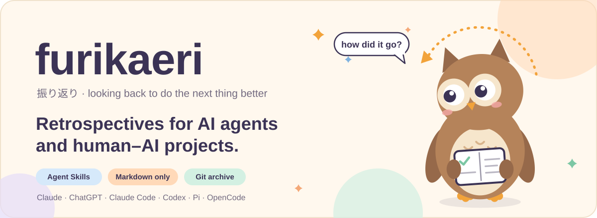
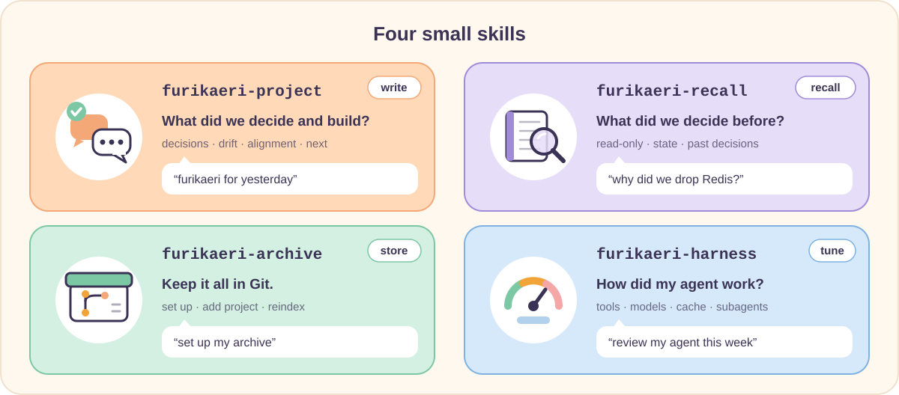
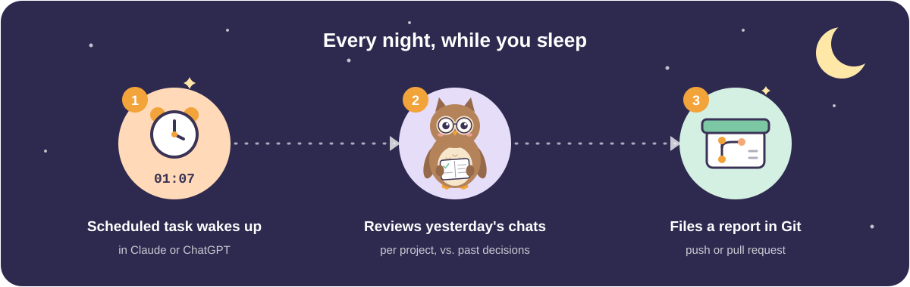

<p align="center">
  
</p>

<p align="center">
  <b>English</b> · <a href="README.ja.md">日本語</a>
</p>

<p align="center">
  
  
  
  
</p>

**furikaeri** (振り返り, *fu-ri-ka-e-ri*, "looking back") is for people who build things with AI. Your AI forgets what you decided in earlier chats. furikaeri writes down what you and your AI decide, keeps it in a private Git repository (the **archive**), and has your AI check it while you work.

It comes as four [Agent Skills](https://agentskills.io): Markdown files of instructions that AI tools such as Claude, ChatGPT, Codex, Pi and OpenCode load when they are relevant. There are no scripts and no database.

## The four skills

<p align="center">
  
</p>

| Skill | What it does | Try saying |
|---|---|---|
| `furikaeri-project` | Looks back at what you and your AI decided and built. Writes a report and files it in the archive. | "furikaeri for yesterday" |
| `furikaeri-recall` | While you work, checks the archive for past decisions. It only reads. | "Why did we drop Redis?" |
| `furikaeri-archive` | Sets up the archive and looks after it. | "Set up my archive" |
| `furikaeri-harness` | Checks how the AI tool itself worked (models, tools, repeated work) and suggests fixes. | "Review how my AI worked this week" |

In `furikaeri-harness`, *harness* means the tool that runs the AI model, such as Claude Code or Codex.

## Quick start

**1. Install**

```bash
npx skills add Aero123421/furikaeri-skills --skill '*' -g
```

It asks which AI tools to install into.

No `npx`, or using the Claude app or ChatGPT? See [other ways to install](docs/GUIDE.md#other-ways-to-install).

**2. Create your archive.** Say this to your AI:

```text
Set up a furikaeri archive at github.com/<you>/furikaeri-archive (private).
```

It asks a few questions: report language, timezone, personal or team.

**3. Add a project**

```text
Add project "acme-api" to my archive.
Repo: github.com/<you>/acme-api. Also called "acme" or "API v2".
```

The other names help later runs find the right project.

You also get two short lines to paste: see [Let your AI remember](#let-your-ai-remember-optional).

**4. Look back**

```text
furikaeri
```

You get a report in the chat. Say yes, and it is saved in the archive.

> [!TIP]
> In a brand-new chat, the AI may not know your archive yet. Name it in the request, like `furikaeri, archive: github.com/<you>/furikaeri-archive`. Or [save it as a default](docs/GUIDE.md#name-your-archive-once).

## Make it daily (optional)

<p align="center">
  
</p>

A scheduled task is a prompt that Claude or ChatGPT runs for you at a set time. Use one to look back every night.

1. In **Claude** or **ChatGPT**, open **Scheduled** and make a new task. Pick a time a little off the hour, like **01:07**.
2. Paste the prompt from [`prompts/scheduled-daily.md`](prompts/scheduled-daily.md) ([日本語版](prompts/scheduled-daily.ja.md)). Fill in your archive, your handle (a short name used in file names) and the source (`claude` or `chatgpt`).
3. After the first run, read the report's **Coverage** section. It says what the task could and couldn't see.

Set it up in both services, and each project gets one report per service.

Using Claude Code or Codex? See the [platform notes](prompts/scheduled-daily.md#platform-notes).

## Let your AI remember (optional)

A record is useless if nobody reads it. Two short lines tell your AI to look in the archive first.

For your project's `AGENTS.md` or `CLAUDE.md` (the file of standing instructions for your AI in that project):

```markdown
## furikaeri
Before starting work or proposing a design here, check `projects/acme-api/INDEX.md` in github.com/you/furikaeri-archive (furikaeri-recall). It is a partial record: what I say now wins.
```

For ChatGPT or Claude memory:

```text
My project decisions are partly recorded in github.com/you/furikaeri-archive. When I start work on a project listed there, or before you propose a design for it, check its INDEX.md first. If it differs from what I say, ask — what I say now wins.
```

When you add a project, `furikaeri-archive` prints both lines with your names filled in.

Then `furikaeri-recall` looks at the project's record in three cases: when you start or resume work, before the AI proposes a design or tool, and when you ask what was decided or why.

## One thing to know

The archive is a partial record. It holds only what your AI could see and wrote down. Meetings, other chats and recent decisions may be missing.

So your AI reads it as background, not as orders. **What you say now always wins.** If it differs from the record, the AI asks once, then follows you.

## More details

All in the [guide](docs/GUIDE.md):

- [Other ways to install](docs/GUIDE.md#other-ways-to-install): copy the folders, Claude app, ChatGPT, and the folder and command for each AI tool
- [Things you can say](docs/GUIDE.md#things-you-can-say), and the periods you can ask for
- [How it fits together](docs/GUIDE.md#how-it-fits-together): the picture
- [What furikaeri-harness checks](docs/GUIDE.md#what-furikaeri-harness-checks)
- [How the AI treats the archive](docs/GUIDE.md#how-the-ai-treats-the-archive)
- [Archive folders and settings](docs/GUIDE.md#archive-folders-and-settings)
- [What a report looks like](docs/GUIDE.md#what-a-report-looks-like)
- [Principles](docs/GUIDE.md#principles)
- [FAQ](docs/GUIDE.md#faq)
- [Repository layout](docs/GUIDE.md#repository-layout)

## Contributing

Issues and pull requests are welcome. Especially useful: where other AI tools keep their session logs ([`log-sources.md`](skills/furikaeri-harness/references/log-sources.md)), translations of the report template, and notes on what scheduled tasks can and can't see.

## License

[MIT](LICENSE)

<p align="center">
  <br>
  <sub>Owls can turn their heads about 270°. Very good at looking back.</sub>
</p>
