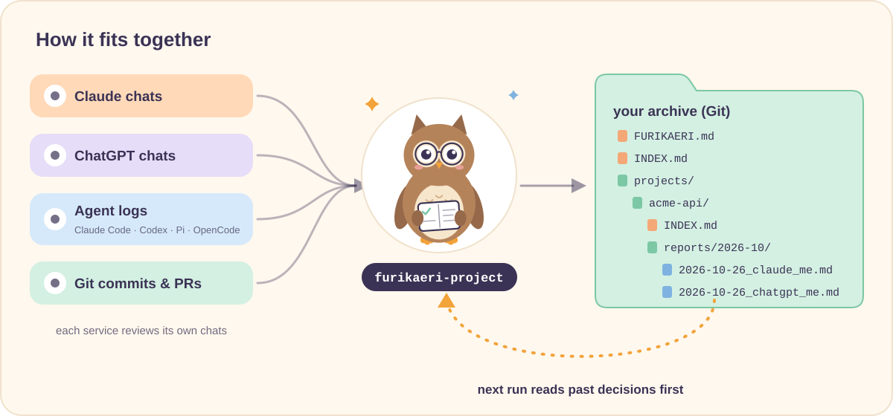

<p align="center">
  <b>English</b> · <a href="GUIDE.ja.md">日本語</a>
</p>

# furikaeri guide

This guide holds the details that the [README](../README.md) leaves out. Read only the parts you need.

- [How it fits together](#how-it-fits-together)
- [Other ways to install](#other-ways-to-install)
- [Things you can say](#things-you-can-say)
- [What furikaeri-harness checks](#what-furikaeri-harness-checks)
- [How the AI treats the archive](#how-the-ai-treats-the-archive)
- [Archive folders and settings](#archive-folders-and-settings)
- [What a report looks like](#what-a-report-looks-like)
- [Principles](#principles)
- [FAQ](#faq)
- [Repository layout](#repository-layout)

## How it fits together

Chats and commits go in. A report goes into the archive. Your AI reads the archive back.

<p align="center">
  
</p>

- **The archive is the memory.** Each project has an `INDEX.md`. It holds the project's current state, a log of decisions, and the names the project goes by (aliases, repositories, keywords). A review reads it first, so it can tell a new decision from a reversed one. `furikaeri-recall` brings it into everyday work.
- **The archive explains itself.** `FURIKAERI.md`, at the top of the archive, holds the settings, file paths, report template and privacy rules. An AI without these skills, such as a ChatGPT scheduled task, can still follow it. A team changes the format by editing this one file.
- **Each service reviews its own chats.** Claude can't read your ChatGPT history, and ChatGPT can't read Claude's. So each one writes its own report into the same project, side by side.
- **The AI reads only a little.** Reports pile up in Git. The AI reads the indexes and the few reports a task needs, never the whole archive.
- **It is a partial record, and it knows it.** See [How the AI treats the archive](#how-the-ai-treats-the-archive).

## Other ways to install

The one-command install is in the [README](../README.md#quick-start). The [`skills` CLI](https://github.com/vercel-labs/skills) asks which AI tools to install into (Claude Code, Codex, OpenCode, Cursor and more). Add `-a claude-code -a codex` to that command to choose them up front.

### Copy the folders

```bash
git clone https://github.com/Aero123421/furikaeri-skills.git
cd furikaeri-skills

# Claude Code (OpenCode reads this folder too)
mkdir -p ~/.claude/skills && cp -r skills/* ~/.claude/skills/

# Codex, Pi, OpenCode
mkdir -p ~/.agents/skills && cp -r skills/* ~/.agents/skills/
```

| AI tool | Skills folder | How to call it |
|---|---|---|
| Claude Code | `~/.claude/skills/` or `.claude/skills/` | `/furikaeri-project` |
| Codex | `~/.agents/skills/` or `.agents/skills/` | `$furikaeri-project` |
| Pi | `~/.agents/skills/` or `~/.pi/agent/skills/` | `/skill:furikaeri-project` |
| OpenCode | `~/.agents/skills/`, `~/.claude/skills/` or `~/.config/opencode/skills/` | just ask; it loads skills by name |

Asking in plain words usually works too, because the AI picks a skill by its description. If it doesn't react, call the skill by name as in the last column.

### Claude app and ChatGPT

Zip each skill folder and upload it as a custom skill:

```bash
cd skills && for s in furikaeri-*; do zip -r "../$s.zip" "$s"; done
```

- **Claude (claude.ai, desktop, mobile):** upload the zips in your Skills settings.
- **ChatGPT:** upload them where your plan supports skills. If it doesn't, you can skip installing: the [scheduled prompt](../prompts/scheduled-daily.md) plus your archive's `FURIKAERI.md` carry the whole method.

> [!TIP]
> `furikaeri-project`, `furikaeri-archive` and `furikaeri-harness` are meant to run when you ask. In Claude Code you can enforce that by adding `disable-model-invocation: true` to the front matter, the settings block at the top of their `SKILL.md` (a Claude Code extension, not part of the standard). Don't add it to `furikaeri-recall`: it has to start on its own while you work.

## Things you can say

| You say | Skill | What happens |
|---|---|---|
| "furikaeri" · "look back on today" | project | Today's work in every project that had activity |
| "furikaeri acme-api last week" | project | One project, Monday to Sunday of last week |
| "look back on Oct 20–26 and open a PR" | project | A date range, published as a pull request (a proposed change on GitHub) |
| "review how my AI worked this week" | harness | How the AI tool worked: models, tools, cache, subagents |
| "anything worth turning into a skill this month?" | harness | Jobs you repeat, with evidence |
| *(you start working on acme-api)* | recall | A brief of at most five lines about the recorded state, once per session |
| "why did we drop Redis?" | recall | The decision, its date and source, or "not in the archive" |
| "add project …" · "reindex the archive" | archive | Looking after the archive: add a project, rebuild its lists |

**Periods:** today (default) · yesterday · last 7 days · last week (Mon–Sun) · last month · a date · a range like `2026-10-01..2026-10-26`. Times use your timezone.

## What furikaeri-harness checks

It reads the session logs that your AI tool keeps (Claude Code, Codex, Pi and OpenCode). It counts what the logs show, and writes "unknown" for anything they don't. It looks at:

- **Models and tokens.** Which models ran, and how much text went in and out. A token is the unit that AI uses to measure text.
- **Cache.** How much input was reused instead of read again. Reuse is faster and cheaper.
- **Compaction.** When a long chat is squeezed into a summary to make room, and what got lost.
- **Tools.** Which tools were called, errors, retries, and the same file read again and again.
- **Skills.** Which skills loaded and when, which loaded for nothing, and which were needed but never loaded.
- **Subagents.** Helper AIs that the main AI starts for side tasks. Did their work overlap? Were their results used?
- **Friction.** Your interruptions, your corrections ("no, I meant…"), things you had to explain twice, and permission denials.

Each finding says what happened, what kind of problem it is, and one of these:

- `ADD`: a new rule or skill is missing.
- `UPDATE`: a rule is wrong or out of date.
- `REMOVE`: a rule gets in the way.
- `NO_CHANGE`: leave things as they are. Often the instructions were fine and the AI just slipped.

It also lists jobs you repeat that could become a skill: seen at least 3 times, in at least 2 sessions. It never edits your files. It proposes the exact change, and a way to check next time that it worked.

In chat apps (claude.ai, ChatGPT) the AI can't read token or cache data, so only the parts that need no numbers apply. If you set an archive, harness reports are filed under `harness/` in it.

It can also check whether `furikaeri-recall` ran before the AI proposed a design. With that, you can tune the lines in [Let your AI remember](../README.md#let-your-ai-remember-optional) using numbers.

## How the AI treats the archive

The archive holds only what your AI could see and chose to write down. These are not in it:

- decisions made in meetings or on Slack,
- decisions in chats without a furikaeri task,
- decisions made with AIs that don't have these skills,
- anything decided since the last report.

Reports are also the AI's reading of events, and their quality varies. Every skill, and the archive's own `FURIKAERI.md`, follow four rules:

- **Not recorded ≠ didn't happen.** The AI says "the archive has no record of X", never "X wasn't decided".
- **Recorded ≠ true now.** What you say now outranks the archive. A mismatch is read as an old record, and the AI asks.
- **Only decisions are decisions.** Lines marked `[interp]` (an interpretation) and `[proposal]` (an idea nobody accepted) are never read back as decisions. Only decisions you made or accepted go into the decision log.
- **Short, labeled, quiet.** Recall shows a few lines marked "from the archive, recorded up to 2026-10-25" (with the real date), raises a clash once, and says nothing when nothing applies.

## Archive folders and settings

```
furikaeri-archive/
├── FURIKAERI.md                    settings, paths, report template, privacy
├── INDEX.md                        all projects + names they go by
├── projects/
│   └── acme-api/
│       ├── INDEX.md                current state · decision log · open questions
│       └── reports/2026-10/
│           ├── 2026-10-26_claude_you.md
│           └── 2026-10-26_chatgpt_you.md
└── harness/you/2026-10/            optional harness reports
```

The settings live in `FURIKAERI.md`:

```yaml
mode: personal          # personal | team
language: en            # report language
timezone: Asia/Tokyo
publish: direct         # direct (push) | pr (pull request)
new-projects: propose   # propose | create
meta-analysis: full     # full | collaboration-only | off
```

- `publish`: `direct` pushes the report straight to the archive. `pr` opens a pull request for someone to approve.
- `new-projects`: when work matches no known project, `propose` only lists it for you to confirm. `create` makes the project by itself.
- `meta-analysis`: how much a report says about how you and the AI work together. `full` includes your own patterns. `collaboration-only` describes the exchange, not the person. `off` skips it.

### Name your archive once

So you don't have to name the archive in every request, write it in the **Defaults** block at the top of the `SKILL.md` of `furikaeri-project`, `furikaeri-recall` and `furikaeri-harness`. The folders are in the table under [Other ways to install](#other-ways-to-install).

```markdown
- Archive: github.com/you/furikaeri-archive
- Author: you
- Timezone: Asia/Tokyo
```

`furikaeri-recall` has only the Archive line. Author is a short handle used in file names.

## What a report looks like

```markdown
# acme-api — 2026-10-26 (claude)

## Decisions
| Decision | Status | Rationale | Evidence |
|---|---|---|---|
| Keep REST, drop the GraphQL spike | changed | latency target met without it | chat 14:20, PR #42 |

## Alignment & drift
- [fact] Asked for "minimal error handling"; the AI added a retry framework.
- [interp] AI drift: the constraint from 10-20 ("no new abstractions") was lost.

## Context that would be lost
- Rejected: caching at the gateway — the auth headers vary per user.
```

- **Status** is `new`, `reaffirmed`, `changed` or `reverted`.
- **Drift** means the work slowly moves away from the original goal. Each shift is sorted: you changed course on purpose, the AI lost a constraint, there was new information, or it can't tell because it may have been decided somewhere the archive doesn't see.
- **Context that would be lost** is the background that git doesn't keep: rejected options and why, failed attempts, next ideas.
- Every claim is labeled `[fact]` (with a source), `[interp]` or `[proposal]`.
- The report language comes from `language` in `FURIKAERI.md` (`en`, `ja`, …). Set it to `ja` and reports are written in Japanese.

A full example from this repo's own design session is in [`examples/`](../examples/projects/furikaeri-skills/reports/2026-10/2026-10-26_multi_aero.md).

## Principles

- **Evidence over memory.** Numbers come from logs, or say "unknown". Every "done" is checked against commits, tests or files.
- **Fact, interpretation and proposal are labeled apart.**
- **Fewer, sharper instructions.** A finding separates the AI's slip from a flaw in your instructions. Narrowing or removing a rule is preferred over adding one.
- **Propose, don't self-edit.** The skills never rewrite your skills, `AGENTS.md` or `CLAUDE.md`. They propose the exact change.
- **Gaps are shown.** Missing logs and chats the AI couldn't reach are reported, never filled in by guessing.
- **The record is partial.** It informs; what you say now decides.
- **People are not graded.** Collaboration notes describe patterns you can observe. They follow your privacy setting and never describe teammates.

## FAQ

<details>
<summary><b>Do I need Python, Node or a server?</b></summary>

No server. The skills are Markdown. To analyze logs, the AI uses tools it already has (`git`, `jq`, `sqlite3`…) in one-off commands. Only the one-command install uses `npx`, which needs Node.js. Copying the folders doesn't.
</details>

<details>
<summary><b>Do I need all four skills?</b></summary>

No. The install adds all four, and you can use them one at a time. `furikaeri-project` works without an archive: the report just stays in the chat. `furikaeri-harness` works on its own. `furikaeri-recall` needs an archive to read.
</details>

<details>
<summary><b>Where does my data go?</b></summary>

Only to the archive repository you choose. Keep it private. Secrets, tokens and raw transcripts are never committed.
</details>

<details>
<summary><b>Can a team share one archive?</b></summary>

Yes. Set `mode: team` and `publish: pr`. Reports carry each author's handle, nobody edits another author's reports, and with `meta-analysis: collaboration-only` the notes describe interaction patterns, not people.
</details>

<details>
<summary><b>Will the archive overrule what I tell my AI?</b></summary>

No. What you say now wins. If it differs from a recorded decision, `furikaeri-recall` asks once ("still true, or changed elsewhere?") and then follows you. The next retrospective records the change.
</details>

<details>
<summary><b>Will it change my AGENTS.md or my skills?</b></summary>

No. `furikaeri-harness` proposes the exact change and a way to check it next time. You decide.
</details>

<details>
<summary><b>Why are older sessions missing from the harness review?</b></summary>

Some AI tools delete their logs. Claude Code, for example, keeps them 30 days by default (`cleanupPeriodDays`). Run furikaeri regularly, or raise the setting.
</details>

## Repository layout

```
skills/
├── furikaeri-harness/   SKILL.md · references/log-sources.md
├── furikaeri-project/   SKILL.md
├── furikaeri-recall/    SKILL.md
└── furikaeri-archive/   SKILL.md · assets/ (FURIKAERI.md, INDEX.md, PROJECT_INDEX.md)
prompts/                 scheduled-daily.md · scheduled-daily.ja.md
examples/                a sample project index and report
docs/                    GUIDE.md · GUIDE.ja.md · images/ (the illustrations)
```
